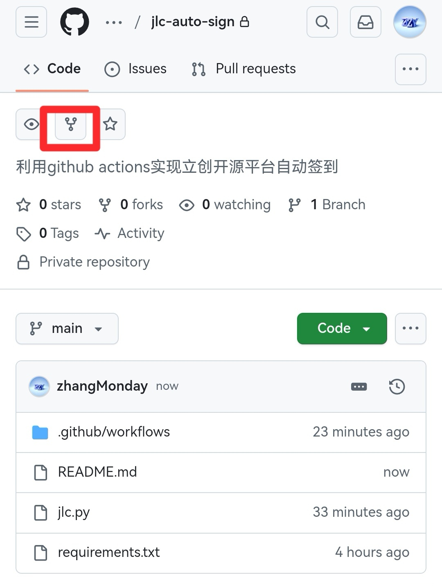
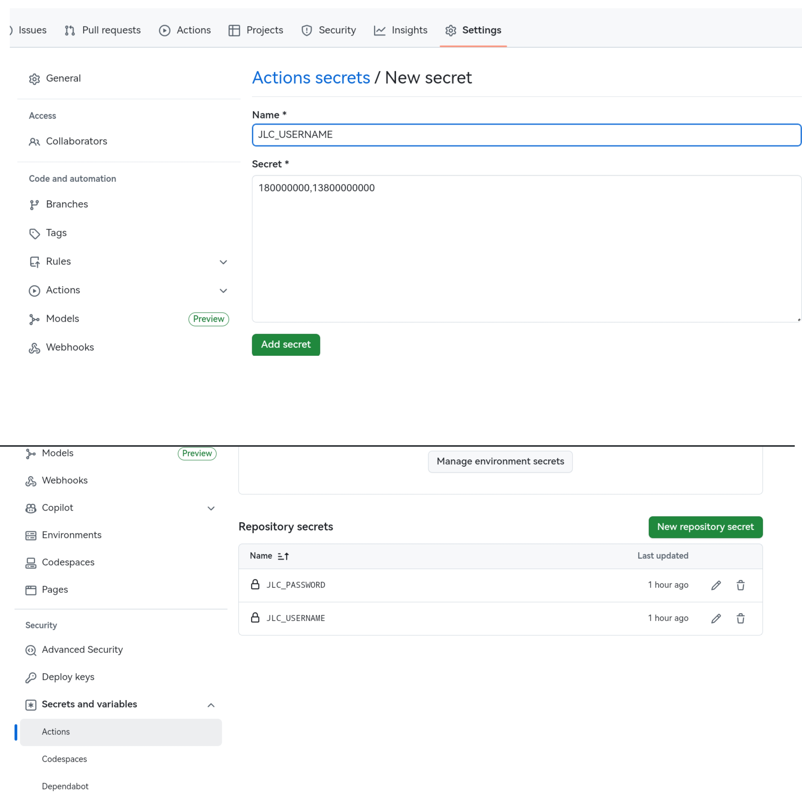
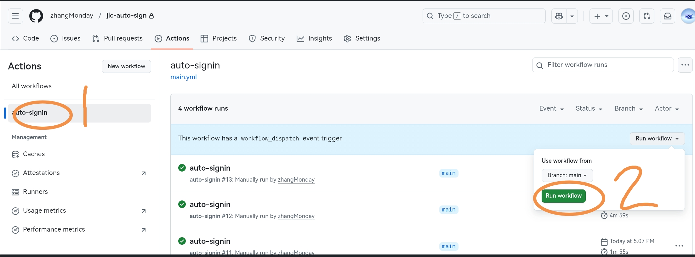
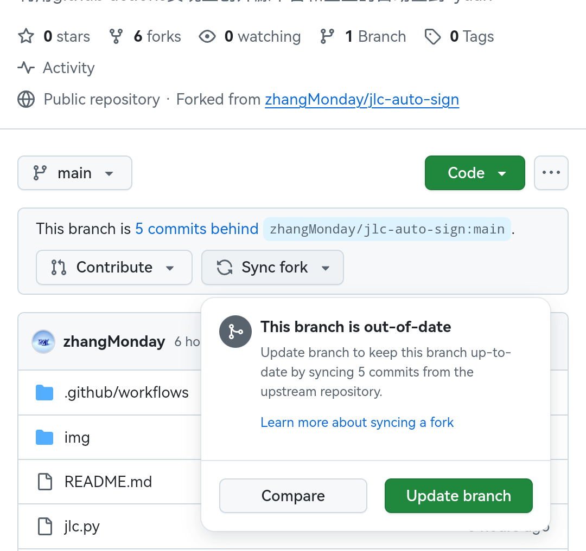
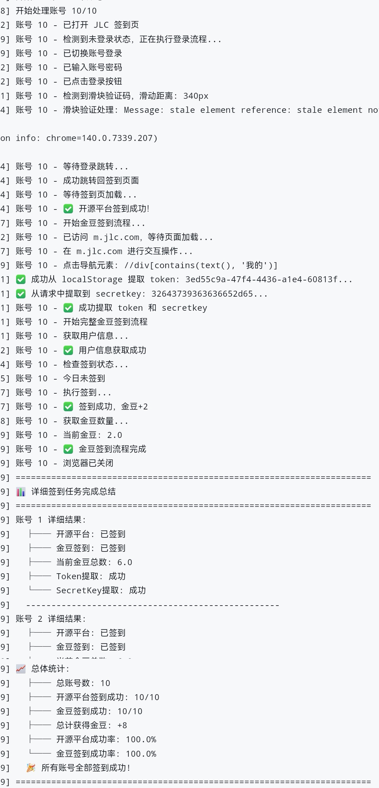

# 嘉立创自动签到工具  
*By zhangMonday*

[立创开源平台](https://oshwhub.com/)

[嘉立创金豆中心](https://activity.jlc.com/goods/goodsList?spm=JLC.MEMBER)

请确保你的立创账号已经在开源平台设置了昵称，否则开源平台自动签到将无法运行

使用缓存凭证时，每个账号只发几次接口请求，通常几秒完成；只有凭证失效需要登录时才要 1~2 分钟（含滑块）。
Github Actions 单次任务执行时长限制在 6 小时以内，即使每个账号都重新登录，也不建议设置超过 70 个账号。
如果有大量账号自动签到需求，可以手动多克隆几个本仓库来批量运行。

---

## 项目简介  
该项目利用 **Github Actions** 实现立创开源平台以及立创金豆的每天自动化签到

支持多账号签到

支持自动过滑块验证（浏览器只负责登录）

积分签到、金豆签到全部走 **接口请求**，不再用浏览器点页面

登录拿到的 Cookie / Token 会缓存到 secret，下次运行直接复用，省掉一次登录

支持金豆第七天/额外奖励自动领取

支持 Server酱3 推送签到总结（多账号可分别配置 SendKey，同 key 自动合并，含积分与金豆明细）

---

## 运行流程（凭证缓存 + 纯接口签到）

```
读取 JLC_CREDENTIALS(secret) ──有缓存──> 接口校验/直接签到
        │                                   │
        └──无缓存/缓存失效──> 浏览器登录（含滑块）──> 提取 Cookie + X-JLC-AccessToken
                                              │
                                   关闭浏览器，只用 requests 签到
                                              │
                                   回写 credentials.json → 更新 secret
                                              │
                                         推送签到总结
```

| 环节 | 实现方式 | 凭证 |
| --- | --- | --- |
| 登录 | Selenium + 阿里云滑块 | 账号密码 |
| 开源平台积分签到 | `GET/POST https://oshwhub.com/api/users*` | Cookie（整串，关键 `oshwhub_session`） |
| 嘉立创金豆签到 | `https://m.jlc.com/api/activity/sign/*` | 请求头 `X-JLC-AccessToken` |

这样即使无头浏览器被风控、或者 Actions 上启动浏览器很慢，只要凭证还有效，签到本身几乎不受影响。
凭证失效（401）时才会重新走一次浏览器登录。

取凭证这一步有几个坑，代码里都已处理，排错时可以对照：

1. **SSO 回跳成功 ≠ 登录态已生效。** 从 passport 跳回 `oshwhub.com` 时 URL 已经变了，
   但 session Cookie 是页面再发一次请求之后才写进去的。只看 URL 就取 Cookie 会拿到
   匿名会话，接着调接口一直 401。所以脚本会在页面里轮询 `GET /api/users`，等它 200 才取凭证。
2. **`m.jlc.com` 必须用移动端 UA 访问。** 桌面 UA 会被强制 302 到 `www.jlc.com`（PC 站），
   PC 站前端不保存 `X-JLC-AccessToken`，怎么翻 localStorage 都拿不到。脚本用 CDP 把 UA
   切成移动端（连 UA-CH 的 `mobile: true` 一起改）再进站取 token，取完切回桌面 UA。
   切完会打印 `当前 UA: 移动端 ✓`，没切成功会打印真实 UA。
3. **金豆用的是另一个 appId（`JLC_MOBILE_APP`），光登录 oshwhub 不够。**
   只登过 `JLC_OSHWHUB` 时，m.jlc.com 的请求头里 `X-JLC-AccessToken` 是字符串 `null`，
   签到就是 `401（用户未登录或会话失效）`。所以取 token 时还会走一次
   `passport.jlc.com/m/login?appId=JLC_MOBILE_APP`——passport 有会话时它是静默跳转，
   不会二次输密码——回跳后 token 才会写进 localStorage。拿到后还会调一次资产接口校验，
   `null` 这种假值不会被存进 secret。
4. **Cookie 要整串带走。** 登录态分散在 `oshwhub_session`、`oshwhub_csrf`、`isLoginCustomerFlag`、
   `jlc_customer_code` 等多个 Cookie 里，只留名字带 `session` 的会缺信息。请求时优先发浏览器
   原样的 Cookie 头，被拒再退回「只用会话 Cookie」重试一次（缓存里的 WAF Cookie 可能属于旧 IP）。

> 开源平台的「7天好礼 / 月度好礼」按钮在页面上是前端弹窗，没有稳定的公开接口，目前不再自动点击；
> 金豆侧的第七天奖励仍会在签到后自动调用 `receiveVoucher` 领取。


---

## 关于滑块验证（阿里云验证码 2.0）

嘉立创登录页的验证码已经从网易易盾换成了**阿里云验证码 2.0**（`#aliyunCaptcha-window-embed`，
"请按住滑块，拖动到最右边"）。相关代码拆成了两个模块：

- `captcha_solver.py`：滑块识别 + 拟人轨迹拖拽
- `stealth.py`：清除 Selenium 自动化特征

实测结论（对本项目的排错很有用）：

1. 只用 `ActionChains` 拖两下必失败，阿里云会分析轨迹的加减速、纵向抖动、采样间隔；
   这里用 CDP `Input.dispatchMouseEvent` 逐点下发，并自己控制事件时间戳，
   轨迹是"先加速、中段巡航、末段减速 + 轻微手抖 + 随机停顿"。
2. 滑块必须**顶到轨道最右端**，差 1px 都会被弹回去重来。
3. **最关键的一点**：即使轨迹完美，前端显示"验证通过"，服务端
   `/api/cas/captcha/v2/check-ali-captcha` 仍会返回 `checkSuccess=false`（"滑块验证失败"）。
   原因是页面里留着驱动注入的 `window.cdc_adoQpoasnfa76pfcZLmcfl_*` 标记。
   这些属性删不掉时会被重定义成 `undefined` 的 getter，`stealth.py` 做的就是这件事，
   顺带补上 `navigator.webdriver`、`window.chrome`、`languages/plugins`、权限查询等指纹。
4. 原代码里的 `--blink-settings=imagesEnabled=false` 会让滑块背景图不渲染、
   元素尺寸变成 0，已移除。

可用环境变量（本地调试用）：

| 变量 | 默认 | 说明 |
| --- | --- | --- |
| `JLC_HEADLESS` | `1` | 设为 `0` 打开浏览器窗口，方便肉眼看拖拽过程 |
| `JLC_BROWSER` | `chrome` | 本地没有 Chrome 时可设为 `edge` |

本地单独验证滑块（不跑签到）：

```bash
python test_captcha.py --account 你的账号 --password 你的密码
python test_captcha.py --account 你的账号 --password 你的密码 --browser edge --headless
python test_captcha.py --fake            # 用假账号触发验证码，只看滑块能不能过
```

脚本会把每一步截图存到 `debug/`，方便判断是"没拖到底"还是"被判定机器"。

---

## 配置方法  

### 1. Fork 项目到自己的仓库  
- 访问项目页面，点击 `Fork` 按钮将项目复制到自己的仓库。  



---

### 2. 配置嘉立创账号和密码  
1. 进入你 Fork 的仓库，点击 **Settings** → **Secrets** → **New repository secret**。  
2. 添加以下两个密钥：  
   - **Name**: `JLC_USERNAME`  
     **Value**: 你的嘉立创登录账户邮箱/手机号/客编，多账号用英文逗号分割，要和密码一一对应
   - **Name**: `JLC_PASSWORD`  
     **Value**: 你的嘉立创登录密码，多账号用英文逗号分割，要和账号一一对应



---

### 2.1 配置凭证持久化（强烈推荐）

登录成功后脚本提取 Cookie 和 `X-JLC-AccessToken`，写到 `credentials.json`；
工作流最后一步用 `gh secret set` 把它写回 **`JLC_CREDENTIALS`**。
下一次运行由环境变量注入，凭证有效就完全不启动浏览器。

凭证只保存在这一个 secret 里，不进 git（`credentials.json` 已写进 `.gitignore`）。

#### 创建 `JLC_SECRET_PAT`

`gh` 修改 secret 不能用 Actions 自带的 `GITHUB_TOKEN`，必须用 PAT：

1. 打开 <https://github.com/settings/tokens> → **Generate new token**
   - **Classic**：勾 `repo`（私有仓库必需）和 `workflow`
   - **Fine-grained**：Repository access 选本仓库，Permissions → **Secrets: Read and write**
2. 仓库 → **Settings → Secrets and variables → Actions → New repository secret**
   - Name: `JLC_SECRET_PAT`，Secret 粘贴 token
   - ⚠️ 必须建在**仓库级**，建在 Environment 里工作流读不到

`JLC_CREDENTIALS` 第一次不用建，跑完会自动创建，之后不要手工改。

#### 怎么确认保存成功

看 `Update credential secret` 这一步：

```
凭证文件: 1653 字节
updated_at: 2026-11-23 18:55:29 | 账号数: 1
凭证已回写
```

下次运行出现 `凭证: 载入 1 个账号（来源 secret JLC_CREDENTIALS）` 和
`账号 1 - 缓存凭证可用，未启动浏览器`，说明持久化生效了。

#### 没保存成功时的对照

| 日志现象 | 原因 |
| --- | --- |
| `本次没有产生新凭证，跳过回写` | 本次用的是仍未失效的旧凭证，本来就不需要写（正常） |
| `未配置 JLC_SECRET_PAT` | 没建这个 secret，或建在了 Environment 里 |
| `凭证回写失败` | PAT 过期 / 无本仓库 Secrets 写权限 / 只读 fork |
| 回写成功但下次仍登录 | 凭证已过期（Cookie 一般几天到一周），或换 IP 被判定新设备 |

#### 失败通知

工作流里 `JLC_FAIL_EXIT: 'true'`，**任意账号的积分或金豆签到失败，脚本最后返回退出码 1**，
这一步会标红、整个 run 失败，GitHub 会给仓库关注者 / 触发者发失败邮件。
Server酱3 推送在退出前完成，所以消息照常能收到。

---

### 3. 配置 Actions 自动化执行  
1. 在你 Fork 的 GitHub 仓库中点击 **Actions**  
2. 按照图示方法启用 GitHub Actions


3. 点击 **Run workflow** 手动触发一次，如果运行结束出现绿色对勾则为成功



---

### 4. 定时自动化执行  
在 `.github/workflows/main.yml` 文件中，根据注释修改自动签到时间。  
如果不修改，默认自动签到时间为北京时间早上 7 点（23:00 UTC）和晚上 19 点（11:00 UTC）

实际运行时间会比设置时间延迟一小时以内，具体取决于当时 GitHub 资源占用情况。

保活用的心跳记录会统一推到独立的 `heartbeat` 分支（首次运行自动创建），分支上只有一个 `heartbeat.txt`，内容是最近一次运行时间；main 分支不再产生空提交。


---

### 5. 获取更新

在你fork的仓库中找到sync fork，点击即可更新，如图



下一次自动签到会自动运行更新后的程序

推荐定期检查更新来优化脚本并获取最新功能

---

### 6. 配置 Server酱3 推送（可选）

签到全部完成后会统一推送一条总结。推送走 [Server酱3](https://sc3.ft07.com/)，
不配置就不会推送。

1. 登录 `https://sc3.ft07.com/`，在 **SendKey** 页面复制你的 SendKey（形如 `sctp12345tAbCd...`）。
2. 在你 Fork 的仓库里 **Settings** → **Secrets** → **New repository secret**，添加：
   - **Name**: `SERVERCHAN3_SCKEY`
   - **Value**: 你的 SendKey

多账号可以给每个账号配不同的 SendKey，**按账号顺序用英文逗号分隔**，和 `JLC_USERNAME` 一一对应：

```
SERVERCHAN3_SCKEY=sctp111tAAA,sctp222tBBB
```

分配规则：

| 情况 | 结果 |
| --- | --- |
| 不配置 | 不推送 |
| 只配一个 `sctp111tAAA` | 所有账号合并成 **一条** 推送 |
| 配两个，共 3 个账号 | 账号 1 用第 1 个、账号 2 用第 2 个、账号 3 回落到第 1 个 |
| 中间留空 `sctp111tAAA,,sctp333tCCC` | 账号 2 回落到第 1 个 |
| 多个账号共用同一个 SendKey | 结果合并成 **一条** 推送，不会重复发 |

推送内容（同一 SendKey 下的账号合并成一条，正文每行之间留空行，适配 Server酱3 的 markdown 渲染）：

```
签到统计

成功：4

已签到：0

失败：0

【签到成功】

✅ 账号(123****78A)：积分 +5（140→145）；金豆 +2（8→10）

✅ 账号(123****79A)：积分今日已签到（71）；金豆 +2（69→71）
```

- **标题**：该条推送里「失败」为 0 时是 `嘉立创签到成功`，否则 `嘉立创签到失败`。
- **签到统计**：按账号统计。`成功` = 本次至少有一项签到拿到奖励；`已签到` = 两项今天都已经签过；
  `失败` = 积分或金豆任意一项失败（含密码错误、凭证失效、接口报错）。
- **明细**：每个账号一行，先积分后金豆，格式为 `+本次奖励（签到前→签到后）`；
  已签到时显示当前积分/金豆；失败时括号里是具体原因（已截断，完整原因看 Actions 日志）。
- **账号打码**：前后各保留 3 位、中间固定 4 个星号（`12345678A` → `123****78A`，邮箱保留域名）。
- 日志里只打印打码后的 SendKey（如 `sctp1234***WxYz`）。

> 注意：Server酱3 和 Server酱Turbo 是两套账号体系，Turbo 的 `SCT...` 开头 key 不能用在这里，
> 旧的 `SERVERCHAN_SCKEY`（Turbo）仍然独立生效。

---

### 本地运行与调试（推荐先在本地验证）

#### 1. 准备环境

需要 Python 3.7+ 和 Chrome（没有 Chrome 会自动改用 Edge）。

```bash
git clone <你的仓库地址>
cd jlc-auto-sign
python -m venv .venv
.venv/Scripts/activate           # macOS / Linux: source .venv/bin/activate
pip install -r requirements.txt
```

selenium 4 会自己下载并匹配浏览器驱动，不用手动装 chromedriver。

#### 2. 先跑自测（不需要真实账号）

```bash
# 只验证「签到页 -> 登录页」这一段，最快（约 10 秒）
.venv/Scripts/python.exe test_captcha.py --fake --only-entry

# 验证完整链路：进登录页 -> 填假账号 -> 过滑块（最后提示"密码不正确"属正常）
.venv/Scripts/python.exe test_captcha.py --fake

# 想肉眼看浏览器操作过程
.venv/Scripts/python.exe test_captcha.py --fake --headful

# 用真实账号完整跑一遍（不写进命令行，避免留在历史记录里）
#   PowerShell:  $env:JLC_USERNAME="你的账号"; $env:JLC_PASSWORD="你的密码"
#   cmd:         set JLC_USERNAME=你的账号 & set JLC_PASSWORD=你的密码
.venv/Scripts/python.exe test_captcha.py
```

每一步的截图会存到 `debug/`（已被 `.gitignore` 忽略），出问题直接看 `01_login_entry.png`、`03_captcha.png`、`04_after_solve.png`。

#### 3. 运行主脚本

```bash
# 参数方式
python jlc.py 账号1,账号2 密码1,密码2 [失败退出标志]

# 环境变量方式（推荐本地调试，密码不落在命令历史里）
python jlc.py            # 自动读 JLC_USERNAME / JLC_PASSWORD
```

#### 4. 环境变量一览

| 变量 | 作用 | 示例 |
| --- | --- | --- |
| `JLC_USERNAME` | 账号，多个用逗号分隔 | `13800138000,abc@qq.com` |
| `JLC_PASSWORD` | 密码，与账号一一对应 | `pwd1,pwd2` |
| `JLC_BROWSER` | 浏览器，`chrome` 或 `edge` | `edge` |
| `JLC_HEADLESS` | 设为 `0` 显示浏览器窗口（默认无头） | `0` |
| `JLC_FAIL_EXIT` | 设为 `true`/`1`/`yes` 时任意账号失败返回非零退出码（工作流已默认开启） | `true` |
| `JLC_CREDENTIALS` | 上次运行留下的凭证 JSON（工作流从 secret 注入） | `{"accounts":{...}}` |
| `JLC_CREDENTIAL_FILE` | 凭证中转文件路径，默认 `credentials.json`（本地调试用） | `credentials.json` |
| `SERVERCHAN3_SCKEY` | Server酱3 推送 key，多个用逗号分隔 | `sctp111tAAA` |

本地第一次运行会走浏览器登录，把凭证写入 `credentials.json`；之后再运行会直接复用，
想强制重新登录就删掉这个文件即可（环境变量 `JLC_CREDENTIALS` 和文件会按账号各取较新的一份，
所以设了环境变量也不用删文件）。

注意：`JLC_HEADLESS=0` 表示「显示窗口」，没有 `JLC_HEADFUL` 这个变量。

注入方式（Windows）：

PowerShell（只对当前窗口有效）：

```powershell
$env:JLC_BROWSER = "edge"
$env:JLC_HEADLESS = "0"
$env:JLC_USERNAME = "13800138000"
$env:JLC_PASSWORD = "你的密码"
.\venv\Scripts\python.exe jlc.py
```

cmd：

```bat
set JLC_BROWSER=edge
set JLC_HEADLESS=0
set JLC_USERNAME=13800138000
set JLC_PASSWORD=你的密码
.venv\Scripts\python.exe jlc.py
```

Git Bash / macOS / Linux（只对本次命令有效）：

```bash
JLC_BROWSER=edge JLC_HEADLESS=0 JLC_USERNAME=13800138000 JLC_PASSWORD=你的密码 \
  .venv/Scripts/python.exe jlc.py
```

清除：PowerShell 用 `Remove-Item Env:JLC_BROWSER`，cmd 用 `set JLC_BROWSER=`。

#### 5. 常见问题

- **卡在「页面未自动跳转」**：签到页里拿不到可见的登录链接，通常是网络慢、页面还没渲染完。脚本会等 12 秒，再退到默认的 passport 登录地址；仍然失败时会打印当前 URL，配合 `debug/` 截图排查。
- **日志说「使用缓存凭证，未启动浏览器」**：正常。说明上次留下的 Cookie/Token 还有效，签到全部走接口。
- **日志说「缓存凭证不可用」**：Cookie 或 Token 过期了（通常是手动退出过账号），脚本会自动重新登录并刷新 secret，无需处理。
- **只失败金豆 / 只失败积分**：看日志里的原因。`凭证失效` 会自动重登；`418 被 WAF 拦截` 是请求被风控，重试通常能过；`success=false` 一般是当天接口限流或活动变更。
- **重登后积分仍 `401（未登录或凭证失效）`**：多半是取凭证的时机不对——SSO 刚跳回时 session Cookie 还没写好。正常日志里应该能看到
  `页面内校验登录态通过`；如果没有，说明页面内 `/api/users` 一直不是 200，往上翻日志看是不是还停在 passport 页。
- **只失败金豆、日志说「没有金豆 access token」**：确认 `fetch_mobile_token` 那段有没有打印
  `切换移动端 UA 访问 m.jlc.com`；如果打印了但还是没有，看紧随其后的「当前地址」是不是 `www.jlc.com`（UA 没切成功）。
- **滑块一直「验证失败」**：先确认 `stealth.py` 注入成功（`window.cdc_*` 标记已抹掉），并检查是否误加了 `--blink-settings=imagesEnabled=false`（会让滑块背景图不渲染、尺寸变 0）。
- **想看错误现场**：加 `JLC_HEADLESS=0`，或给 `test_captcha.py` 加 `--keep`，浏览器不会自动关，可以直接在窗口里操作。

#### 6. 无头模式 / GitHub Actions 注意事项

无头模式最容易踩的坑是 **UA 请求头里的 `HeadlessChrome`**：

- `--headless` 启动的浏览器，HTTP 请求头里的 User-Agent 是 `...HeadlessChrome/xxx...`；
- 只在页面里改 `navigator.userAgent` 没用，服务端和 WAF 看的是请求头；
- oshwhub 的 WAF（瑞数 CloudWAF）会把这类请求直接拦掉，返回 **418「访问被拦截！」**，
  表现为：登录明明成功、也跳回了签到页，但 `/api/users` 取不到昵称和积分，后续签到全失败。

脚本已在 `create_driver()` 里用 CDP `Emulation.setUserAgentOverride` 在会话层覆盖 UA
（自动取当前浏览器真实版本，去掉 `Headless` 字样，不写死版本号），Windows / Ubuntu 都适用。
启动时会打印：

```
[18:13:26] 已覆盖无头 UA 请求头（去掉 Headless 标识）
```

如果看到的是 `警告: UA 覆盖未生效`，说明当前驱动不支持 CDP，需要升级浏览器或驱动。

排查顺序（无头失败时按这个走）：

1. 日志里有 `422/418`、`访问被拦截`、`/api/users 被 WAF 拦截` → UA / 指纹问题；
2. 日志里 `/api/users` 是 `401` → 会话没建立，看上面的登录流程；
3. `无法获取用户昵称` 后面紧跟着签到失败 → 基本就是第 1 条。

另外无头模式的 `screen` 会报成 800×600（窗口却是 1920×1080），`stealth.py` 会一起修正，
避免「高分辨率窗口 + 十几年前的分辨率」这种明显矛盾。

GitHub Actions（ubuntu-22.04 + Chrome + selenium 3.141）额外注意：

- 工作流里不需要装 xvfb，脚本本身就是无头；
- Chrome 低于 109 时 `--headless=new` 会被自动降级成 `--headless`；
- 服务器 IP 属于机房段，风控更严，偶尔需要重试，脚本自带重试逻辑。

---

### 成功运行结果（节选）


## 致谢  
本项目参考和复用了 [https://github.com/wmathor/Check_In](https://github.com/wmathor/Check_In) 的部分代码，感谢！

本项目参考了 [https://github.com/sudojia/AutoTaskScript](https://github.com/sudojia/AutoTaskScript/) 的嘉立创脚本，感谢！

欢迎提交issue和PR，如果本项目对你有帮助，请给我点个star~
