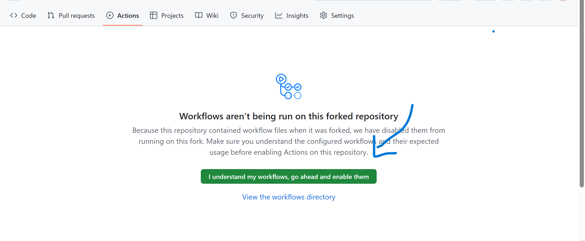
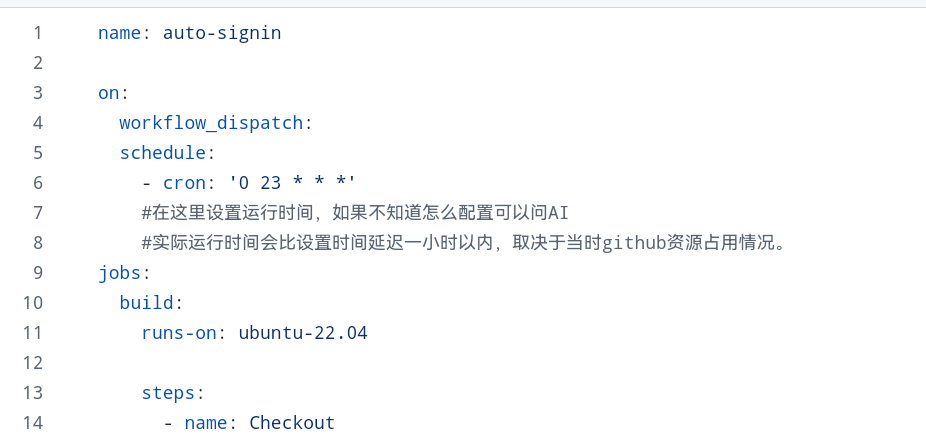

# 嘉立创自动签到工具  
*By zhangMonday*

[立创开源平台](https://oshwhub.com/)

[嘉立创金豆中心](https://activity.jlc.com/goods/goodsList?spm=JLC.MEMBER)

请确保你的立创账号已经在开源平台设置了昵称，否则开源平台自动签到将无法运行

每个账号完整跑完签到流程用时至多5分钟，Github Actions单次任务执行时长限制在6小时以内，因此不建议设置自动签到70个账号以上。如果有大量账号自动签到需求，可以手动多克隆几个本仓库来批量运行。

---

## 项目简介  
该项目利用 **Github Actions** 实现立创开源平台以及立创金豆的每天自动化签到

支持多账号签到

支持自动领取7日礼包和每月礼包

支持自动过滑块验证

支持自动通过登录信息抓包X-JLC-AccessToken和secretkey实现金豆签到

支持金豆奖励领取

支持 Server酱3 推送签到总结（多账号可分别配置 SendKey，同 key 自动合并）

---

## 关于滑块验证（阿里云验证码 2.0）

嘉立创登录页的验证码已经从网易易盾换成了**阿里云验证码 2.0**（`#aliyunCaptcha-window-embed`，
"请按住滑块，拖动到最右边"）。相关代码拆成了两个模块：

- `captcha_solver.py`：滑块识别 + 拟人轨迹拖拽
- `stealth.py`：清除 Selenium 自动化特征

实测结论（对本项目的排错很有用）：

1. 只用 `ActionChains` 拖两下必失败，阿里云会分析轨迹的加减速、纵向抖动、采样间隔；
   这里用 CDP `Input.dispatchMouseEvent` 逐点下发，并自己控制事件时间戳，
   轨迹是"先加速、中段巡航、末段减速 + 轻微手抖 + 随机停顿"。
2. 滑块必须**顶到轨道最右端**，差 1px 都会被弹回去重来。
3. **最关键的一点**：即使轨迹完美，前端显示"验证通过"，服务端
   `/api/cas/captcha/v2/check-ali-captcha` 仍会返回 `checkSuccess=false`（"滑块验证失败"）。
   原因是页面里留着驱动注入的 `window.cdc_adoQpoasnfa76pfcZLmcfl_*` 标记。
   这些属性删不掉时会被重定义成 `undefined` 的 getter，`stealth.py` 做的就是这件事，
   顺带补上 `navigator.webdriver`、`window.chrome`、`languages/plugins`、权限查询等指纹。
4. 原代码里的 `--blink-settings=imagesEnabled=false` 会让滑块背景图不渲染、
   元素尺寸变成 0，已移除。

可用环境变量（本地调试用）：

| 变量 | 默认 | 说明 |
| --- | --- | --- |
| `JLC_HEADLESS` | `1` | 设为 `0` 打开浏览器窗口，方便肉眼看拖拽过程 |
| `JLC_BROWSER` | `chrome` | 本地没有 Chrome 时可设为 `edge` |

本地单独验证滑块（不跑签到）：

```bash
python test_captcha.py --account 你的账号 --password 你的密码
python test_captcha.py --account 你的账号 --password 你的密码 --browser edge --headless
python test_captcha.py --fake            # 用假账号触发验证码，只看滑块能不能过
```

脚本会把每一步截图存到 `debug/`，方便判断是"没拖到底"还是"被判定机器"。

---

## 配置方法  

### 1. Fork 项目到自己的仓库  
- 访问项目页面，点击 `Fork` 按钮将项目复制到自己的仓库。  


---

### 2. 配置嘉立创账号和密码  
1. 进入你 Fork 的仓库，点击 **Settings** → **Secrets** → **New repository secret**。  
2. 添加以下两个密钥：  
   - **Name**: `JLC_USERNAME`  
     **Value**: 你的嘉立创登录账户邮箱/手机号/客编，多账号用英文逗号分割，要和密码一一对应
   - **Name**: `JLC_PASSWORD`  
     **Value**: 你的嘉立创登录密码，多账号用英文逗号分割，要和账号一一对应


---

### 3. 配置 Actions 自动化执行  
1. 在你 Fork 的 GitHub 仓库中点击 **Actions**  
2. 按照图示方法启用 GitHub Actions



3. 点击 **Run workflow** 手动触发一次，如果运行结束出现绿色对勾则为成功


---

### 4. 定时自动化执行  
在 `.github/workflows/main.yml` 文件中，根据注释修改自动签到时间。  
如果不修改，默认自动签到时间为北京时间早上 7 点（23:00 UTC）和晚上 19 点（11:00 UTC）

实际运行时间会比设置时间延迟一小时以内，具体取决于当时 GitHub 资源占用情况。

保活用的心跳记录会统一推到独立的 `heartbeat` 分支（首次运行自动创建），分支上只有一个 `heartbeat.txt`，内容是最近一次运行时间；main 分支不再产生空提交。



---

### 5. 获取更新

在你fork的仓库中找到sync fork，点击即可更新，如图


下一次自动签到会自动运行更新后的程序

推荐定期检查更新来优化脚本并获取最新功能

---

### 6. 配置 Server酱3 推送（可选）

签到全部完成后会统一推送一条总结。推送走 [Server酱3](https://sc3.ft07.com/)，
不配置就不会推送。

1. 登录 `https://sc3.ft07.com/`，在 **SendKey** 页面复制你的 SendKey（形如 `sctp12345tAbCd...`）。
2. 在你 Fork 的仓库里 **Settings** → **Secrets** → **New repository secret**，添加：
   - **Name**: `SERVERCHAN3_SCKEY`
   - **Value**: 你的 SendKey

多账号可以给每个账号配不同的 SendKey，**按账号顺序用英文逗号分隔**，和 `JLC_USERNAME` 一一对应：

```
SERVERCHAN3_SCKEY=sctp111tAAA,sctp222tBBB
```

分配规则：

| 情况 | 结果 |
| --- | --- |
| 不配置 | 不推送 |
| 只配一个 `sctp111tAAA` | 所有账号合并成 **一条** 推送 |
| 配两个，共 3 个账号 | 账号 1 用第 1 个、账号 2 用第 2 个、账号 3 回落到第 1 个 |
| 中间留空 `sctp111tAAA,,sctp333tCCC` | 账号 2 回落到第 1 个 |
| 多个账号共用同一个 SendKey | 结果合并成 **一条** 推送，不会重复发 |

推送内容（同一 SendKey 下的账号合并成一条，正文每行之间留空行，适配 Server酱3 的 markdown 渲染）：

```
签到统计

成功：4

已签到：0

失败：0

【签到成功】

✅ 账号(123****78A)：获取2个金豆，当前总数：90.0

✅ 账号(123****79A)：获取2个金豆，当前总数：71.0
```

- **标题**：该条推送里「失败」为 0 时是 `嘉立创签到成功`，否则 `嘉立创签到失败`。
- **签到统计**：按金豆签到结果计数。`成功` = 本次签到拿到金豆；`已签到` = 今天之前已经签过；
  `失败` = 签到失败、Token 提取失败、密码错误等。
- **账号打码**：前后各保留 3 位、中间固定 4 个星号（`12345678A` → `123****78A`，邮箱保留域名）。
- 日志里只打印打码后的 SendKey（如 `sctp1234***WxYz`）。

> 注意：Server酱3 和 Server酱Turbo 是两套账号体系，Turbo 的 `SCT...` 开头 key 不能用在这里，
> 旧的 `SERVERCHAN_SCKEY`（Turbo）仍然独立生效。

---

### 本地部署说明

如果你希望在本地环境运行此脚本，可以按照以下步骤进行配置：

环境要求

· Python 3.7 或更高版本

· Chrome 浏览器

· ChromeDriver（与Chrome版本匹配）

安装步骤

1. 克隆项目到本地

```bash
git clone https://github.com/zhangMonday/jlc-auto-sign.git
cd jlc-auto-sign
```

2. 安装Python依赖

```bash
pip install selenium requests
```

3. 安装ChromeDriver
   · 访问[ChromeDriver](https://developer.chrome.com/docs/chromedriver/downloads)下载页面
   · 下载与你的Chrome版本匹配的ChromeDriver
   
   · 将ChromeDriver添加到系统PATH中：
   
     · Windows: 解压到 C:\Windows\system32\
   
     · Linux/macOS: 解压到 /usr/local/bin/

5. 运行脚本

```bash
python jlc.py 账号1,账号2,账号3... 密码1,密码2,密码3...
```

---

### 成功运行结果（节选）


## 致谢  
本项目参考和复用了 [https://github.com/wmathor/Check_In](https://github.com/wmathor/Check_In) 的部分代码，感谢！

本项目参考了 [https://github.com/sudojia/AutoTaskScript](https://github.com/sudojia/AutoTaskScript/) 的嘉立创脚本，感谢！

欢迎提交issue和PR，如果本项目对你有帮助，请给我点个star~
